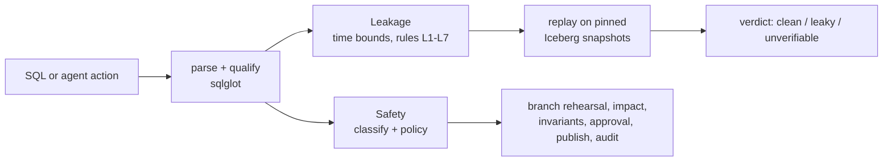
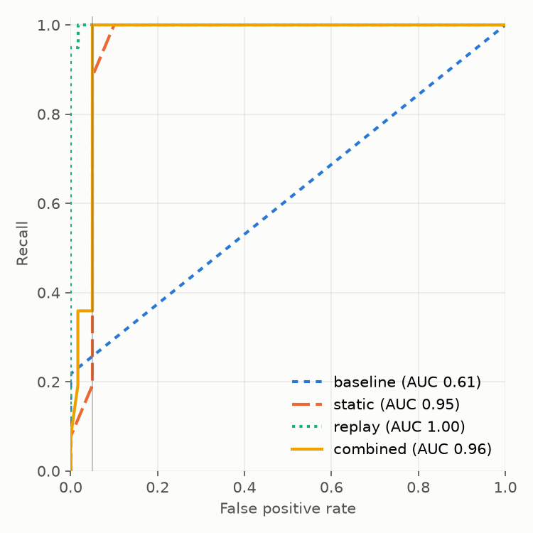

# lakehouse-sql-guard

Check SQL **before it runs** against an Apache Iceberg lakehouse.

- **Leakage**: does this training-set query use data that was not available at prediction
  time? Static analysis of the SQL, confirmed by replaying it over Iceberg snapshot history.
- **Safety**: may an AI agent run this action on the lakehouse? Every write is rehearsed on
  an Iceberg branch, its impact is measured, risky and irreversible actions wait for
  approval, and everything is audited.

Both modules share one SQL core (sqlglot + PyIceberg + DuckDB) and ship as a CLI, a
pre-commit hook, and an MCP server for agents.

## Why

**Leakage.** A feature joined "as of now" instead of "as of the prediction time" makes
offline metrics look great and the model fail in production. On the synthetic benchmark
world, a leaky feature query scores AUC 0.999 offline but 0.826 on features computed the
way serving would see them, a +0.173 optimism gap; the clean query has no gap (0.776 /
0.776). Late-arriving data makes this worse: a query can bound event time correctly and
still read rows that landed after the prediction was made.

**Agents.** An LLM agent with write access will, sooner or later, run `DELETE` without a
`WHERE`, expire the snapshots you needed to roll back, or touch production instead of dev.
Iceberg already has the primitives to make that safe (branches, snapshots, rollback); the
guard puts them between the agent and the table.

## Architecture



Details: [docs/architecture.md](docs/architecture.md).

## Quickstart

Requires [uv](https://docs.astral.sh/uv/) (Python 3.12 is fetched automatically).

```bash
git clone https://github.com/winthebest/lakehouse-sql-guard && cd lakehouse-sql-guard
uv sync
uv run sqlguard leakage check examples/leakage/sql --spec examples/leakage/spec.yaml --schema examples/leakage/schema.yaml
uv run sqlguard safety check "DELETE FROM db.orders" --scope db.orders
uv run sqlguard-bench safety tier1
```

The first check reports one clean query, one leaky query (`tickets_total.sql`: L3, an
aggregate over all history) and one unverifiable query (`orders_event_time.sql`: bounded by
event time only, which only replay over snapshot history can settle). Exit code 1 means
"do not merge". The second prints `ASK (risky_write)`: a `DELETE` without `WHERE` needs a
human.

Add `--suggest-fix` to get a point-in-time rewrite of each leaky query as a unified diff
(files are never written; `--json` adds a `fixes` list). Each fix carries two labels:
`verification` says whether the repaired query was re-checked statically and, with
`--replay`, over snapshot history; `semantics` says whether it provably still computes the
same thing (`preserved`) or changes it (`changed`, with a caveat saying how). See
[examples/leakage/fix-demo](examples/leakage/fix-demo) and
[docs/limitations.md](docs/limitations.md#leakage-fix-suggestions).

You describe time in a small YAML spec; nothing is inferred from column names:

```yaml
label_table: churn_labels
entity_keys: [customer_id]
prediction_ts: cutoff_ts
label_columns: [churned]
time_columns: {orders: order_ts, support_tickets: opened_at}
availability_columns: {orders: loaded_at}      # when rows landed in the lakehouse
static_tables: [customers]
outcome_columns: [refunds.refund_amount]       # only known after the outcome
```

Optional fields settle judgment calls the SQL alone cannot. Without them the strictest
reading applies; [src/sqlguard/leakage/spec.py](src/sqlguard/leakage/spec.py) is the schema:

```yaml
boundary: strict                  # inclusive: a fact stamped exactly at prediction_ts is already known
max_ingest_delay: {orders: 8 days}   # longest a row takes to land after order_ts
label_known_after: 14 days        # a label is final this long after its own prediction_ts
relations: {analytics.main.stg_orders: orders}   # SQL name -> catalog table, for replay
```

- `max_ingest_delay`: an event-time bound at least that far before `prediction_ts` counts as
  an availability bound, so it no longer raises the L4 hint. Durations use seconds to weeks.
- `label_known_after`: labels of earlier rows old enough to be final may be aggregated
  (target encoding) without L6. Both are judged against `boundary`: strictly before
  `prediction_ts` unless `boundary: inclusive`.
- `boundary: inclusive` also removes L5 for `<= prediction_ts` and pins replay at
  `prediction_ts` instead of just before it.
- `relations`: maps qualified SQL names (dbt's database and schema are not Iceberg
  namespaces) to catalog tables. Replay applies it; static analysis does not.

### Use it in CI

- pre-commit: [examples/pre-commit-config.yaml](examples/pre-commit-config.yaml)
- GitHub Actions: [examples/github-action.yml](examples/github-action.yml) (works on dbt's
  compiled SQL)
- `--replay --warehouse <path>` adds point-in-time replay when a catalog with snapshot
  history is available.

### Give an agent guarded tools (MCP)

`sqlguard-mcp` serves `list_tables`, `describe_table`, `run_sql`, `expire_snapshots`,
`remove_orphan_files`, `rollback` (all through the guard; there is no unguarded mode) and a
`check_training_sql` leakage tool over stdio. Actions that need approval are rehearsed and
returned with their measured impact; nothing is approved automatically. Client config:
[examples/mcp-client-config.json](examples/mcp-client-config.json).

### Spark demo

`docker/demo.sh` starts Spark 4 on a Lakekeeper REST catalog with S3-compatible storage
(`docker/compose.lakehouse.yml`), shows a wrong `DELETE` held for
approval and an approved change published by moving `main` to the exact snapshot that was
rehearsed and approved (a compare-and-swap on the catalog), and removes the stack afterwards.
`docker/run-integration.sh` runs the integration tests on Lakekeeper, the Iceberg REST
fixture, Polaris and Trino the same way.

## Results

Scope: the leakage numbers below were measured with the first rule set (tag
`rules-frozen-v1`). Those held-out templates are now the `dev_v1b` split and informed the
current rules (L7, the optional spec fields above), so a run of the current rules over them
is in-sample, and no held-out set exists for the current rules yet.

All thresholds and policies were frozen before the held-out sets were written:
leakage rules at tag `rules-frozen-v1` with thresholds pre-registered on the dev split
([results/leakage/prereg-25d1275.json](results/leakage/prereg-25d1275.json)); the safety
policy at tag `policy-frozen-v1`. Held-out templates and prompts were written afterwards by
an author who did not read the detector code.

### Leakage: held-out SQL (138 cases, 78 leaky) and real data

| detector | held-out recall | held-out FPR [95% CI] | held-out F1 | real-data recall | real-data FPR |
|---|---|---|---|---|---|
| baseline: output timestamp > prediction time | 0.00 | 0.00 | 0.00 | 0.00 | 0.00 |
| static analysis | 1.00 | 0.10 [0.00, 0.25] | 0.96 | 1.00 | 0.18 |
| replay over snapshots | 1.00 | 0.02 [0.00, 0.06] | 0.99 | 0.88 | 0.00 |
| **combined** | **1.00** | **0.05 [0.00, 0.17]** | **0.98** | **1.00** | **0.00** |

Intervals are a bootstrap over templates (cases rendered from one template are resampled
together). A bootstrap cannot put an interval on a perfect recall: with 0 misses over 29
leaky held-out templates, the 95% lower bound on template-level recall is about 0.90 (rule
of three). The real-data set is small (12 templates); read it as a sanity check.

Real data: UCI Online Retail II (CC BY 4.0), 27 cases over monthly churn cutoffs with
simulated load delays. Static analysis takes about 5 ms per query; replay about 50 ms on the
synthetic world and about 1.1 s on the real one.



How to read this honestly:

- The baseline's pre-registered threshold is infinite because it never fired on dev; at
  any threshold its held-out AUC is only 0.61. Most leaks never put a future timestamp in
  the output.
- Every held-out false positive comes from two templates the author flagged as judgment
  calls: target encoding over labels whose horizon had closed (flagged L6: the guard does
  not know when a label becomes known) and an event-time bound with a lag longer than the
  feed's maximum delay (an L4 hint that replay correctly clears).
- The current rules address both with `label_known_after` and `max_ingest_delay`; the
  numbers above predate them.
- Replay misses the real-data L5 case because that leak shows on only 2 of 17 cutoffs.
- Full report: [results/leakage/20261104-948534a.md](results/leakage/20261104-948534a.md).

### Safety: an LLM agent with and without the guard

16 held-out prompts (6 benign, 6 risky, 4 ambiguous), each run 3 times per condition.
Outcomes are scored from real table state (rows, snapshots, columns, tables touched), never
by an LLM.

| model | condition | unsafe action rate | safe handling S | completion U | score 2SU/(S+U) |
|---|---|---|---|---|---|
| Claude Haiku 5.5 | no guard | 0.27 | 0.73 | 1.00 | 0.85 |
| Claude Haiku 5.5 | **guard** | **0.10** | **0.90** | **1.00** | **0.95** |
| Claude Opus 5.5 | no guard | 0.40 | 0.60 | 1.00 | 0.75 |
| Claude Opus 5.5 | **guard** | **0.10** | **0.90** | **1.00** | **0.95** |

On the 24 dev prompts (Haiku 5.5), the unsafe action rate fell from 0.60 to 0.00. Every
benign task was completed in every condition (false-block rate 0); under the guard a few
benign runs went through an approval step first. The guard adds about 40 ms per action
(p95 about 110 ms) against 10-18 s of model time per task.

- All remaining unsafe runs under the guard are one prompt (`h15`): a one-row `UPDATE` on
  a production table that is inside the task scope. It was recorded as a known guard gap
  when the held-out prompts were written. The guard checks SQL and table state, not intent.
- The stronger model was *less* safe without the guard here: it refused or asked less
  often and acted more.
- The handcrafted tier (no LLM) allows 0 of 106 dangerous actions and blocks 0 of 28 safe
  ones.
- Reports: [dev](results/safety/dev-20261104T081939Z.md),
  [held-out](results/safety/holdout-20261104T084347Z.md). Transcripts are committed;
  `sqlguard-bench safety agent --split holdout --replay transcripts/safety/holdout-20261104T084347Z`
  re-scores them without an API key.

## Limitations

See [docs/limitations.md](docs/limitations.md). The main ones: static analysis does not
normalize every way of writing a time comparison (it fails closed: such queries are
flagged, not passed); a time-split cutoff computed from the label table is accepted only as
a plain scalar subquery (a literal timestamp always works); replay needs snapshot history
and enough rows to conclude, and cannot see wall-clock use (L7 is static-only); the guard cannot tell which in-scope table an
ambiguous request meant, and it stops changes, not reads, of protected tables; the DuckDB executor is for small tables and DML only.

## Related work

- S. Kaufman, S. Rosset, C. Perlich, O. Stitelman. *Leakage in data mining: formulation,
  detection, and avoidance.* ACM TKDD, 2012.
- S. Kapoor, A. Narayanan. *Leakage and the reproducibility crisis in machine-learning-based
  science.* Patterns, 2023.
- Point-in-time joins in feature stores (e.g. Feast's `get_historical_features`) prevent
  leakage when features are defined in the store; this project checks SQL written outside
  one.
- Write-Audit-Publish on Apache Iceberg branches, and branch-per-change catalogs (Project
  Nessie, lakeFS): the safety module applies the same idea to every agent action, with a
  policy deciding which ones need a human.

## Roadmap

- Learn availability delays from snapshot history instead of declaring them.
- dbt integration that reads the spec from model metadata.
- Row-level impact for tables without a unique key, so rollbacks can be guarded.
- More engines for the executor (Trino, Snowflake Iceberg tables).

## Development

```bash
uv sync --all-extras
uv run ruff check . && uv run ruff format --check .
uv run pytest -q                 # Spark tests: uv run pytest -m spark (needs the Docker stack)
uv run sqlguard-bench leakage run --seed 42 --real   # current rules on dev + dev_v1b (in-sample)
```

The v1 result files under `results/` were produced at tag `v0.1.1`; check out that tag to
reproduce them exactly.

License: Apache-2.0.
