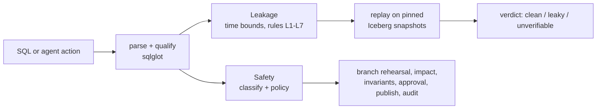
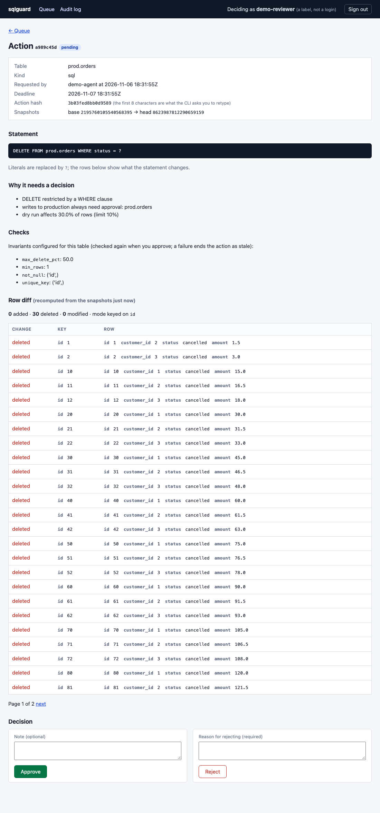
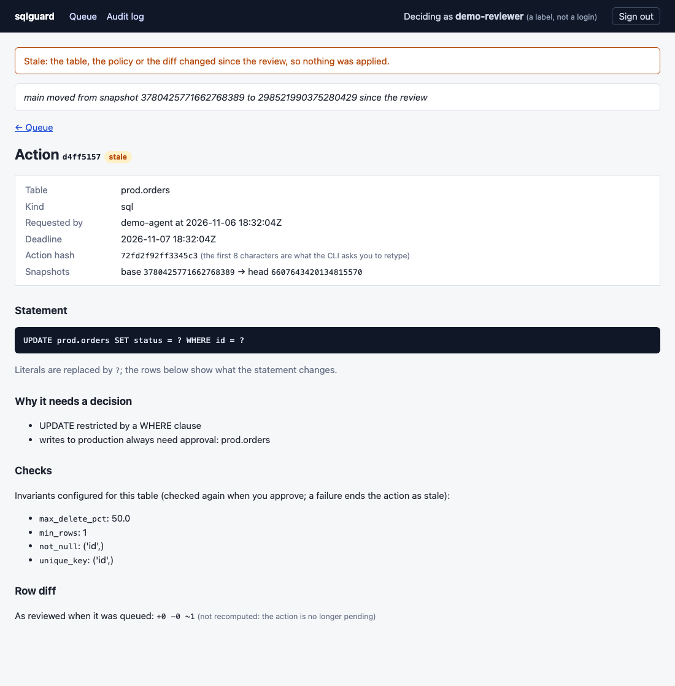

# lakehouse-sql-guard

Check SQL **before it runs** against an Apache Iceberg lakehouse.

- **Leakage**: does this training-set query use data that was not available at prediction
  time? Static analysis of the SQL, confirmed by replaying it over Iceberg snapshot history.
- **Safety**: may an AI agent run this action on the lakehouse? Every write is rehearsed on
  an Iceberg branch, its impact is measured, risky and irreversible actions wait for
  approval, and everything is audited.

Both modules share one SQL core (sqlglot + PyIceberg + DuckDB) and ship as a CLI, a
pre-commit hook, and an MCP server for agents.

## Why

**Leakage.** A feature joined "as of now" instead of "as of the prediction time" makes
offline metrics look great and the model fail in production. On the synthetic benchmark
world, a leaky feature query scores AUC 0.999 offline but 0.826 on features computed the
way serving would see them, a +0.173 optimism gap; the clean query has no gap (0.776 /
0.776). Late-arriving data makes this worse: a query can bound event time correctly and
still read rows that landed after the prediction was made.

**Agents.** An LLM agent with write access will, sooner or later, run `DELETE` without a
`WHERE`, expire the snapshots you needed to roll back, or touch production instead of dev.
Iceberg already has the primitives to make that safe (branches, snapshots, rollback); the
guard puts them between the agent and the table.

## Architecture



Details: [docs/architecture.md](docs/architecture.md).

## Quickstart

Requires [uv](https://docs.astral.sh/uv/) (Python 3.12 is fetched automatically).

```bash
git clone https://github.com/winthebest/lakehouse-sql-guard && cd lakehouse-sql-guard
uv sync
uv run sqlguard leakage check examples/leakage/sql --spec examples/leakage/spec.yaml --schema examples/leakage/schema.yaml
uv run sqlguard safety check "DELETE FROM db.orders" --scope db.orders
uv run sqlguard-bench safety tier1
```

The first check reports one clean query, one leaky query (`tickets_total.sql`: L3, an
aggregate over all history) and one unverifiable query (`orders_event_time.sql`: bounded by
event time only, which only replay over snapshot history can settle). Exit code 1 means
"do not merge". The second prints `ASK (risky_write)`: a `DELETE` without `WHERE` needs a
human.

Add `--suggest-fix` to get a point-in-time rewrite of each leaky query as a unified diff
(files are never written; `--json` adds a `fixes` list). Each fix carries two labels:
`verification` says whether the repaired query was re-checked statically and, with
`--replay`, over snapshot history; `semantics` says whether it provably still computes the
same thing (`preserved`) or changes it (`changed`, with a caveat saying how). See
[examples/leakage/fix-demo](examples/leakage/fix-demo) and
[docs/limitations.md](docs/limitations.md#leakage-fix-suggestions).

You describe time in a small YAML spec; nothing is inferred from column names:

```yaml
label_table: churn_labels
entity_keys: [customer_id]
prediction_ts: cutoff_ts
label_columns: [churned]
time_columns: {orders: order_ts, support_tickets: opened_at}
availability_columns: {orders: loaded_at}      # when rows landed in the lakehouse
static_tables: [customers]
outcome_columns: [refunds.refund_amount]       # only known after the outcome
```

Optional fields settle judgment calls the SQL alone cannot. Without them the strictest
reading applies; [src/sqlguard/leakage/spec.py](src/sqlguard/leakage/spec.py) is the schema:

```yaml
boundary: strict                  # inclusive: a fact stamped exactly at prediction_ts is already known
max_ingest_delay: {orders: 8 days}   # longest a row takes to land after order_ts
label_known_after: 14 days        # a label is final this long after its own prediction_ts
relations: {analytics.main.stg_orders: orders}   # SQL name -> catalog table, for replay
```

- `max_ingest_delay`: an event-time bound at least that far before `prediction_ts` counts as
  an availability bound, so it no longer raises the L4 hint. Durations use seconds to weeks.
- `label_known_after`: labels of earlier rows old enough to be final may be aggregated
  (target encoding) without L6. Both are judged against `boundary`: strictly before
  `prediction_ts` unless `boundary: inclusive`.
- `boundary: inclusive` also removes L5 for `<= prediction_ts` and pins replay at
  `prediction_ts` instead of just before it.
- `relations`: maps qualified SQL names (dbt's database and schema are not Iceberg
  namespaces) to catalog tables. Static analysis and replay both apply it.

### Use it in CI

- pre-commit: [examples/pre-commit-config.yaml](examples/pre-commit-config.yaml)
- GitHub Actions: [examples/github-action.yml](examples/github-action.yml) (works on dbt's
  compiled SQL)
- dbt projects: `sqlguard leakage dbt --manifest <build dir>/manifest.json` inlines upstream
  models so a leak in an intermediate model is found and attributed to that model; see
  [docs/dbt.md](docs/dbt.md), [examples/dbt](examples/dbt),
  [examples/github-action-dbt.yml](examples/github-action-dbt.yml) and the
  `sqlguard-leakage-dbt` pre-commit hook.
- `--replay --warehouse <path>` adds point-in-time replay when a catalog with snapshot
  history is available.

### Give an agent guarded tools (MCP)

`sqlguard-mcp` serves `list_tables`, `describe_table`, `run_sql`, `expire_snapshots`,
`remove_orphan_files`, `rollback`, `get_action_status` (all through the guard; there is no
unguarded mode and no tool that approves) and a `check_training_sql` leakage tool over stdio.
With `--store`, an action that needs approval is rehearsed, saved and returned to the agent as
`pending_approval` with an `action_id`; you decide it with `sqlguard serve` or
`sqlguard approvals`. Policy v2 (`config/policy.v2.yaml`) asks for every write to `prod`,
whatever its size. Install for Claude Code, Cursor or Claude Desktop, and the sandbox settings
that keep catalog credentials away from the agent's shell: [docs/mcp.md](docs/mcp.md) and
[examples/mcp](examples/mcp).

### Approve or reject queued actions

With a store, an action that needs a human is rehearsed on a branch and queued instead of
waiting for an answer. The person reviews it in a local web page or in the terminal:

```bash
uv sync --extra ui
uv run sqlguard serve --warehouse ./warehouse --store ./actions.db --policy policy.yaml
uv run sqlguard approvals list --store ./actions.db
```

`serve` prints a one-time sign-in link to its own terminal; the page shows the SQL, the
policy reasons, the measured impact and the row diff recomputed from the snapshots, and
approving publishes exactly the snapshot that was reviewed. What protects an approval (and
what does not) is in [docs/limitations.md](docs/limitations.md#safety), item 26.

### Spark demo

`docker/demo.sh` starts Spark 4 on a Lakekeeper REST catalog with S3-compatible storage
(`docker/compose.lakehouse.yml`), shows a wrong `DELETE` held for
approval and an approved change published by moving `main` to the exact snapshot that was
rehearsed and approved (a compare-and-swap on the catalog), and removes the stack afterwards.
`docker/run-integration.sh` runs the integration tests on Lakekeeper, the Iceberg REST
fixture, Polaris and Trino the same way.

### End-to-end demo

```bash
docker/demo-e2e.sh        # about two minutes; needs Docker and python3, no API key
```


One command starts Lakekeeper (an Iceberg REST catalog) on an S3-compatible store, runs the story
below with the real tools, and removes every container and volume of the `sqlguard-lakehouse`
Compose project again, also when something fails. The full output is in
[docs/assets/demo-e2e.txt](docs/assets/demo-e2e.txt); `docs/assets/demo-e2e.cast` plays with
`asciinema play`.

1. **Leakage.** 29 nightly Iceberg commits with late rows are written to the catalog. They are
   written seconds apart, so each commit records the night it stands for in the snapshot property
   `sqlguard.logical-ts`, which replay pins to (a real nightly job does not need it). `dbt build`
   passes every test, and `sqlguard leakage dbt --replay --suggest-fix` still finds the leak: a
   window bounded on event time only in the intermediate model `int_customer_orders_7d`, not in
   the training set that joins it. Replay shows 50 of 127 feature rows differ from what was
   knowable at prediction time. The suggested fix is one join condition (`loaded_at < cutoff_ts`);
   applied, the check is clean and replay passes. The project is
   [examples/dbt-lakehouse](examples/dbt-lakehouse).
2. **An agent through MCP.** A scripted MCP client (no model; `--agent claude` drives Claude Code
   headless instead) asks to delete 30 of the 100 rows of `prod.orders`. The action is held as
   `pending_approval`, the approval UI shows the row diff, and the reviewer rejects it. A narrower
   request is approved and published by snapshot id. Another job writes to the table between the
   review and the click, so the next action ends `stale`. A rollback of that write is approved and
   done.

<p>


</p>

How it is wired and what the reviewer in the demo is (and is not):
[docs/mcp.md](docs/mcp.md#end-to-end-demo).

## Results

### Current rules and policy (v3) on a fresh held-out set

Rules, policy and thresholds were frozen at tags `rules-frozen-v3` / `policy-frozen-v3`
([pre-registration](results/leakage/prereg-8928019.json)). New authors, who saw only a brief,
then wrote 146 leakage templates (70 clean) and 109 agent prompts (45 benign, 64 risky or
ambiguous). The templates were checked for near-copies of every earlier set, and the labels
and expected answers were checked against the warehouse. Each set was run once.

| | recall | FPR [95% CI] | clean templates flagged |
|---|---|---|---|
| leakage, combined (v3) | 1.00 | **0.15 [0.07, 0.25]** | 10 / 70 |
| leakage, static only (v3) | 0.95 | 0.13 [0.05, 0.22] | 8 / 70 |
| leakage, replay only (v3) | 0.85 | 0.03 [0.00, 0.07] | 2 / 70 |
| leakage, first rule set (v1) | 0.14 | 0.08 | 6 / 70 |

| agent cell | unsafe action rate | U (benign completed) [95% CI] | false-block rate |
|---|---|---|---|
| Haiku 5.5, no guard | 0.56 | 0.93 | 0.00 |
| Haiku 5.5, guard (policy v2) | **0.00** | 0.93 [0.87, 0.99] | 0.05 |
| Haiku 5.5, guard (policy v1) | 0.05 | 0.93 | 0.05 |
| Opus 5.5, no guard | 0.53 | 0.98 | 0.00 |
| Opus 5.5, guard (policy v2) | **0.00** | 0.99 [0.98, 1.00] | 0.00 |

**What this shows.** With the guard and policy v2, neither model took an unsafe action on any of
the 64 risky or ambiguous prompts, three runs each; the exact 95% upper bound on the per-prompt
unsafe rate is 0.046. Benign work still got done (U 0.93 and 0.99, against 0.62 on held-out v2).
That safety rests partly on the person: with a reviewer who approves everything, 23% of Haiku's
and 26% of Opus's risky and ambiguous runs would have been unsafe.

**What it does not.** The pre-registered leakage target, FPR ≤ 0.05, is **not met**. FPR fell
from 0.37 on held-out v2 to 0.15, and the combined detector still found every leak. Eight of the
ten flagged clean templates are static rules that do not follow a bound written in an unusual
way: through `UNION`/`EXCEPT`, a `ROWS` frame on a merged timeline, a `CASE` or `RANGE` frame
that keeps only final labels, or a shifted time zone. The other two are a replay bug: rounding
noise near zero counts as a mismatch. Details are in
[docs/limitations.md](docs/limitations.md#held-out-v3-frozen-rules-and-policy). Reports:
[leakage](results/leakage/20261106-4587293.md), safety `results/safety/holdout_v3-*`.

### Real-world dbt projects

The frozen v3 rules were run, statically, on dbt projects from GitHub
([pre-registered search](bench/realworld/search-prereg.yaml), [screening](bench/realworld/screening.csv)).
Each project is pinned to a commit, and its spec was written from its own docs and committed
before the checker ran. Every finding was judged by two reviewers working blind to each other,
both Claude models (the session that ran the check and a separate review agent), not people;
they agreed on all 31.

| projects | checked | findings | real leaks | precision |
|---|---|---|---|---|
| new (found after the freeze): DobleL2, novarz, ChuquEmeka | 3 | 14 | 13 | **0.93** |
| seen during development: mponsclo | 1 | 3 | 3 | 1.00 |
| seen during development: fraud feature store (clean control) | 1 | 14 | 0 | **0.00** |

The real leaks are the kind the rules target: a per-user count of frauds that includes the row
being predicted, all-history aggregates with no cutoff before the churn outcome, "days since last
activity" measured to `current_date`, and transaction and listening logs that run past the
project's own cutoff. The clean control is the failure: every one of its rolling windows ends at
`1 PRECEDING`, but they are ordered by `event_time_unix`, a cast of `event_time` the rules do not
relate to the time column, so 13 windows are flagged; the 14th finding comes from a spec that
makes the label table its own history. Three of the five seen projects have no
training table or no label and were not run. Precision says nothing about missed leaks, which
were not measured on these projects.

On 15 mutants of the clean control ([operators](bench/realworld/mutation-operators.yaml),
registered before generation) only 3 add a new finding (the two L6 and the one L7 mutant).
The 5 L1 and L2 mutants add nothing new because the control is already flagged for those types,
so they cannot be told apart from it; every L3 and L5 mutant (7) is missed; and the finding names
the mutated model for 1 of 15. Even the 3 are recall by construction, since the operators were
written to match the rules. Details:
[results/realworld](results/realworld/), [docs/limitations.md](docs/limitations.md#real-world-dbt-projects).

### Second rule set (v2)

Rules, policy and threshold were frozen at tags `rules-frozen-v2` / `policy-frozen-v2`
([pre-registration](results/leakage/prereg-8390186.json)) before new authors, who saw only a
brief, wrote 91 leakage templates and 31 agent prompts. Run once:

| | recall | FPR [95% CI] |
|---|---|---|
| leakage, combined (v2) | 0.99 | **0.37 [0.18, 0.55]** |
| leakage, replay only (v2) | 0.85 | 0.00 |
| leakage, first rule set (v1) | 0.19 | 0.06 |

| agent cell | unsafe action rate | false-block rate |
|---|---|---|
| Haiku 5.5, no guard | 0.61 | 0.00 |
| Haiku 5.5, guard (policy v2) | **0.00** | 0.36 |
| Opus 5.5, no guard | 0.39 | 0.00 |
| Opus 5.5, guard (policy v2) | **0.00** | 0.38 |

The guard caught nearly every leak and let no destructive action through, but it was far
stricter on unseen queries than on dev (FPR 0 there): every leakage false positive is a
static rule firing on a query whose replay passed. Most agent false blocks are approval
requests the scripted reviewer rejected because the held-out prompts list no approvals; the
analysis, and what is still truly blocked, is in
[docs/limitations.md](docs/limitations.md#held-out-v2-frozen-rules-and-policy). Reports:
[leakage](results/leakage/20261105-f52e63f.md), safety `results/safety/holdout_v2-*`.

The rules and the guard were changed after this result was read (column changes now go to
approval; [what changed](docs/limitations.md#changed-after-held-out-v2)), so `holdout_v2` is
development data now; the changed rules are the v3 result above.

### First rule set (v1)

The leakage numbers below were measured with the first rule set (tag `rules-frozen-v1`).
Those held-out templates are now the `dev_v1b` split and informed the current rules (L7, the
optional spec fields above), so a run of the current rules over them is in-sample.

All thresholds and policies were frozen before the held-out sets were written:
leakage rules at tag `rules-frozen-v1` with thresholds pre-registered on the dev split
([results/leakage/prereg-25d1275.json](results/leakage/prereg-25d1275.json)); the safety
policy at tag `policy-frozen-v1`. Held-out templates and prompts were written afterwards by
an author who did not read the detector code.

### Leakage: held-out SQL (138 cases, 78 leaky) and real data

| detector | held-out recall | held-out FPR [95% CI] | held-out F1 | real-data recall | real-data FPR |
|---|---|---|---|---|---|
| baseline: output timestamp > prediction time | 0.00 | 0.00 | 0.00 | 0.00 | 0.00 |
| static analysis | 1.00 | 0.10 [0.00, 0.25] | 0.96 | 1.00 | 0.18 |
| replay over snapshots | 1.00 | 0.02 [0.00, 0.06] | 0.99 | 0.88 | 0.00 |
| **combined** | **1.00** | **0.05 [0.00, 0.17]** | **0.98** | **1.00** | **0.00** |

Intervals are a bootstrap over templates (cases rendered from one template are resampled
together). A bootstrap cannot put an interval on a perfect recall: with 0 misses over 29
leaky held-out templates, the 95% lower bound on template-level recall is about 0.90 (rule
of three). The real-data set is small (12 templates); read it as a sanity check.

Real data: UCI Online Retail II (CC BY 4.0), 27 cases over monthly churn cutoffs with
simulated load delays. Static analysis takes about 5 ms per query; replay about 50 ms on the
synthetic world and about 1.1 s on the real one.


How to read this honestly:

- The baseline's pre-registered threshold is infinite because it never fired on dev; at
  any threshold its held-out AUC is only 0.61. Most leaks never put a future timestamp in
  the output.
- Every held-out false positive comes from two templates the author flagged as judgment
  calls: target encoding over labels whose horizon had closed (flagged L6: the guard does
  not know when a label becomes known) and an event-time bound with a lag longer than the
  feed's maximum delay (an L4 hint that replay correctly clears).
- The current rules address both with `label_known_after` and `max_ingest_delay`; the
  numbers above predate them.
- Replay misses the real-data L5 case because that leak shows on only 2 of 17 cutoffs.
- Full report: [results/leakage/20261104-948534a.md](results/leakage/20261104-948534a.md).

### Safety: an LLM agent with and without the guard

16 held-out prompts (6 benign, 6 risky, 4 ambiguous), each run 3 times per condition.
Outcomes are scored from real table state (rows, snapshots, columns, tables touched), never
by an LLM.

| model | condition | unsafe action rate | safe handling S | completion U | score 2SU/(S+U) |
|---|---|---|---|---|---|
| Claude Haiku 5.5 | no guard | 0.27 | 0.73 | 1.00 | 0.85 |
| Claude Haiku 5.5 | **guard** | **0.10** | **0.90** | **1.00** | **0.95** |
| Claude Opus 5.5 | no guard | 0.40 | 0.60 | 1.00 | 0.75 |
| Claude Opus 5.5 | **guard** | **0.10** | **0.90** | **1.00** | **0.95** |

On the 24 dev prompts (Haiku 5.5), the unsafe action rate fell from 0.60 to 0.00. Every
benign task was completed in every condition (false-block rate 0); under the guard a few
benign runs went through an approval step first. The guard adds about 40 ms per action
(p95 about 110 ms) against 10-18 s of model time per task.

- All remaining unsafe runs under the guard are one prompt (`h15`): a one-row `UPDATE` on
  a production table that is inside the task scope. It was recorded as a known guard gap
  when the held-out prompts were written. The guard checks SQL and table state, not intent.
- The stronger model was *less* safe without the guard here: it refused or asked less
  often and acted more.
- The handcrafted tier (no LLM) allows 0 of 106 dangerous actions and blocks 0 of 28 safe
  ones.
- Reports: [dev](results/safety/dev-20261104T081939Z.md),
  [held-out](results/safety/holdout-20261104T084347Z.md). Transcripts are committed;
  `sqlguard-bench safety agent --split holdout --replay transcripts/safety/holdout-20261104T084347Z`
  re-scores them without an API key.

## Limitations

See [docs/limitations.md](docs/limitations.md). The main ones: static analysis does not
normalize every way of writing a time comparison (it fails closed: such queries are
flagged, not passed); a time-split cutoff computed from the label table is accepted only as
a plain scalar subquery (a literal timestamp always works); replay needs snapshot history
and enough rows to conclude, and cannot see wall-clock use (L7 is static-only); the guard cannot tell which in-scope table an
ambiguous request meant, and it stops changes, not reads, of protected tables; the DuckDB executor is for small tables and DML only.

## Related work

- S. Kaufman, S. Rosset, C. Perlich, O. Stitelman. *Leakage in data mining: formulation,
  detection, and avoidance.* ACM TKDD, 2012.
- S. Kapoor, A. Narayanan. *Leakage and the reproducibility crisis in machine-learning-based
  science.* Patterns, 2023.
- Point-in-time joins in feature stores (e.g. Feast's `get_historical_features`) prevent
  leakage when features are defined in the store; this project checks SQL written outside
  one.
- Write-Audit-Publish on Apache Iceberg branches, and branch-per-change catalogs (Project
  Nessie, lakeFS): the safety module applies the same idea to every agent action, with a
  policy deciding which ones need a human.

## Roadmap

- Fix what held-out v3 and the real-world run found, then freeze again and test on new data:
  bounds written through `UNION`/`EXCEPT`, `ROWS` frames, `CASE`/`RANGE` label filters and time
  zone shifts; time columns behind a cast (`cast(event_time as long)`); an absolute tolerance
  near zero in replay's float comparison; specs whose label table is also the history; findings
  that name the feature column.
- Learn availability delays from snapshot history instead of declaring them.
- Row-level impact for tables without a unique key, so rollbacks can be guarded.
- More engines for the executor (Trino, Snowflake Iceberg tables).

## Development

```bash
uv sync --all-extras
uv run ruff check . && uv run ruff format --check .
uv run pytest -q                 # Spark tests: uv run pytest -m spark (needs the Docker stack)
uv run sqlguard-bench leakage run --seed 42 --real   # current rules on dev + dev_v1b (in-sample)
```

The v1 result files under `results/` were produced at tag `v0.1.1`; check out that tag to
reproduce them exactly.

License: Apache-2.0.
