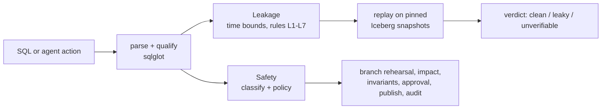

<h1 align="center">lakehouse-sql-guard</h1>

<p align="center">
  <strong>Check SQL before it runs against an Apache Iceberg lakehouse.</strong><br>
  Catch training-set queries that leak the future, and put every write an AI agent makes behind a
  rehearsal and a human review.
</p>

<p align="center">
  <a href="https://github.com/winthebest/lakehouse-sql-guard/actions/workflows/ci.yml"></a>
  <a href="https://github.com/winthebest/lakehouse-sql-guard/releases/latest"></a>
  
  <a href="LICENSE"></a>
</p>

<p align="center">
  <a href="#quickstart">Quickstart</a> ·
  <a href="#results-at-a-glance">Results</a> ·
  <a href="docs/architecture.md">Architecture</a> ·
  <a href="docs/dbt.md">dbt</a> ·
  <a href="docs/mcp.md">MCP</a> ·
  <a href="docs/limitations.md">Limitations</a>
</p>

<p align="center">
  
</p>

## Why

**Leakage.** A feature joined "as of now" instead of "as of the prediction time" makes offline
metrics look great and the model fail in production. On the benchmark's synthetic world, a leaky
feature query scores AUC 0.999 offline but 0.826 on features computed the way serving would see
them; the clean query scores 0.776 both ways. Late-arriving data makes it worse: a query can bound
event time correctly and still read rows that landed after the prediction was made.

**Agents.** An LLM agent with write access will, sooner or later, run `DELETE` without a `WHERE`,
expire the snapshots you needed to roll back, or touch production instead of dev. Iceberg already
has the primitives to make that safe (branches, snapshots, rollback); the guard puts them between
the agent and the table.

## Features

**Leakage checker**

- Seven leak types (L1–L7), from look-ahead windows to wall-clock features, found by static
  analysis of the SQL with [sqlglot](https://github.com/tobymao/sqlglot).
- Replay over Iceberg snapshot history: the query is re-run as of each prediction time and the
  rows compared, which settles what static analysis cannot.
- Point-in-time fix suggestions as a unified diff, each re-checked and labelled with whether it
  still computes the same thing.
- dbt: checks the compiled manifest, inlines upstream models and names the model the leak is in.
- Runs as a CLI, a pre-commit hook or a GitHub Action; exit code 1 means "do not merge".

**Guarded agent actions**

- Every write is rehearsed on an Iceberg branch and its impact measured before anything changes.
- A policy allows, asks or denies; actions that need a person are queued as `pending_approval`.
- The approval UI and CLI show the SQL, the policy reasons and the row diff; approving publishes
  exactly the snapshot that was reviewed, and a write by someone else in between makes it `stale`.
- Rollback and an audit log of every action.
- An MCP server for Claude Code, Cursor and Claude Desktop, with no unguarded mode and no tool that
  approves.

Both share one SQL core (sqlglot, PyIceberg, DuckDB) and work with Iceberg REST catalogs such as
Lakekeeper and Polaris, and with Spark and Trino.

## Results at a glance

Rules and policy were frozen at a git tag before new authors wrote each held-out set, and each set
was run once. Numbers from the current release (rules and policy v3):

| | measured on | result |
|---|---|---|
| Unsafe agent actions with the guard | 64 risky or ambiguous prompts × 3 runs, Claude Haiku 5.5 and Opus 5.5 | **0** (95% upper bound 0.046); 56% and 53% without the guard |
| Benign agent tasks completed with the guard | 45 benign prompts × 3 runs | 0.93 (Haiku), 0.99 (Opus) |
| Leakage recall | 146 held-out SQL templates, 76 leaky | 1.00 |
| Leakage false-positive rate | the 70 clean templates | **0.15 [0.07, 0.25]**: misses the pre-registered target of 0.05 |
| Precision on real dbt projects | 3 GitHub projects found after the freeze | 13 of 14 findings; 0 of 14 on a clean control |

The guard's safety partly rests on the reviewer: one who approves everything would have let 23%
(Haiku) and 26% (Opus) of the risky runs through. The false positives, the failed control and every
earlier rule set are analysed in [docs/results.md](docs/results.md) and
[docs/limitations.md](docs/limitations.md).

## Quickstart

Requires [uv](https://docs.astral.sh/uv/); Python 3.12 is fetched automatically.

```bash
git clone https://github.com/winthebest/lakehouse-sql-guard && cd lakehouse-sql-guard
uv sync
uv run sqlguard leakage check examples/leakage/sql \
  --spec examples/leakage/spec.yaml --schema examples/leakage/schema.yaml
uv run sqlguard safety check "DELETE FROM db.orders" --scope db.orders
```

The first command reports one clean query, one leaky query (`tickets_total.sql`: L3, an aggregate
over all history) and one unverifiable query (`orders_event_time.sql`: bounded by event time only,
which only replay over snapshot history can settle). The second prints `ASK (risky_write)`: a
`DELETE` without `WHERE` needs a human.

Time is never inferred from column names; you describe it in a small spec
([all fields](docs/spec.md)):

```yaml
label_table: churn_labels
entity_keys: [customer_id]
prediction_ts: cutoff_ts
label_columns: [churned]
time_columns: {orders: order_ts, support_tickets: opened_at}
availability_columns: {orders: loaded_at}      # when rows landed in the lakehouse
static_tables: [customers]
```

Add `--suggest-fix` for a point-in-time rewrite of each leaky query, and `--replay --warehouse <path>`
to confirm a verdict over snapshot history ([fix examples](examples/leakage/fix-demo)).

## Usage

### In CI

- pre-commit: the hooks `sqlguard-leakage` and `sqlguard-leakage-dbt`
  ([.pre-commit-hooks.yaml](.pre-commit-hooks.yaml)); example config in
  [examples/pre-commit-config.yaml](examples/pre-commit-config.yaml)
- GitHub Actions: [examples/github-action.yml](examples/github-action.yml) and, for dbt,
  [examples/github-action-dbt.yml](examples/github-action-dbt.yml)

### dbt projects

```bash
dbt compile --target-path build_ci --select "+config.meta.leakage.role:training_set"
sqlguard leakage dbt --manifest build_ci/manifest.json --suggest-fix
```

Upstream models are inlined, so a leak in an intermediate model is found and attributed to that
model, not to the training set that joins it. Declaring time in model `meta`, replay and exit
codes: [docs/dbt.md](docs/dbt.md), example project [examples/dbt](examples/dbt).

### Agents through MCP

`sqlguard-mcp` serves `list_tables`, `describe_table`, `run_sql`, `expire_snapshots`,
`remove_orphan_files`, `rollback`, `get_action_status` and a `check_training_sql` leakage tool over
stdio, all through the guard. With `--store`, an action that needs approval is rehearsed, saved
and returned to the agent as `pending_approval` with an `action_id`. Policy v2
(`config/policy.v2.yaml`) asks for every write to `prod`, whatever its size. Setup for each client,
and the sandbox settings that keep catalog credentials away from the agent's shell:
[docs/mcp.md](docs/mcp.md), [examples/mcp](examples/mcp).

### Review queued actions

```bash
uv sync --extra ui
uv run sqlguard serve --warehouse ./warehouse --store ./actions.db --policy policy.yaml
uv run sqlguard approvals list --store ./actions.db
```

`serve` prints a one-time sign-in link to its own terminal. The page shows the SQL, the policy
reasons, the measured impact and the row diff recomputed from the snapshots.

<p>
  
  
</p>

What protects an approval, and what does not: [docs/limitations.md](docs/limitations.md#safety).

## Demos

```bash
docker/demo-e2e.sh        # about two minutes; needs Docker and python3, no API key
```

One command starts Lakekeeper (an Iceberg REST catalog) on S3-compatible storage, runs the story
with the real tools, and removes every container and volume again, also when something fails:

1. **Leakage.** 29 nightly Iceberg commits with late rows are loaded. `dbt build` passes every test,
   yet `sqlguard leakage dbt --replay --suggest-fix` finds a window bounded on event time only in
   the intermediate model `int_customer_orders_7d`; replay shows 50 of 127 feature rows differ from
   what was knowable at prediction time. The suggested one-line fix makes the check clean.
2. **An agent through MCP.** A scripted MCP client (`--agent claude` drives Claude Code headless
   instead) asks to delete 30 of 100 rows of `prod.orders`. The action is held, the reviewer sees
   the diff and rejects it; a narrower request is approved and published by snapshot id; a write by
   another job makes the next action `stale`; a rollback is approved.

The full output is in [docs/assets/demo-e2e.txt](docs/assets/demo-e2e.txt), and how the demo is
wired in [docs/mcp.md](docs/mcp.md#end-to-end-demo). A shorter Spark 4 demo is `docker/demo.sh`, and
`docker/run-integration.sh` runs the integration tests on Lakekeeper, Polaris, the Iceberg REST
fixture and Trino.

## How it works



## Documentation

| | |
|---|---|
| [Architecture](docs/architecture.md) | the SQL core, the leakage pipeline, pending actions and publishing |
| [Time spec](docs/spec.md) | every spec field, and the optional ones that settle judgment calls |
| [dbt](docs/dbt.md) | checking a dbt project, time in model `meta`, replay on a lakehouse |
| [MCP](docs/mcp.md) | the agent tools, client setup, the end-to-end demo |
| [Results](docs/results.md) | every held-out run, v1 to v3, and the real-world dbt projects |
| [Limitations](docs/limitations.md) | what the guard gets wrong or cannot see, and why |

## Related work

- S. Kaufman, S. Rosset, C. Perlich, O. Stitelman. *Leakage in data mining: formulation, detection,
  and avoidance.* ACM TKDD, 2012.
- S. Kapoor, A. Narayanan. *Leakage and the reproducibility crisis in machine-learning-based
  science.* Patterns, 2023.
- Point-in-time joins in feature stores (e.g. Feast's `get_historical_features`) prevent leakage
  when features are defined in the store; this project checks SQL written outside one.
- Write-Audit-Publish on Apache Iceberg branches, and branch-per-change catalogs (Project Nessie,
  lakeFS): the safety module applies the same idea to every agent action, with a policy deciding
  which ones need a human.

## Roadmap

- Fix what held-out v3 and the real-world run found, then freeze again and test on new data:
  bounds written through `UNION`/`EXCEPT`, `ROWS` frames, `CASE`/`RANGE` label filters and time
  zone shifts; time columns behind a cast (`cast(event_time as long)`); an absolute tolerance near
  zero in replay's float comparison; specs whose label table is also the history; findings that
  name the feature column.
- Learn availability delays from snapshot history instead of declaring them.
- Row-level impact for tables without a unique key, so rollbacks can be guarded.
- More engines for the executor (Trino, Snowflake Iceberg tables).

## Development

```bash
uv sync --all-extras
uv run ruff check . && uv run ruff format --check .
uv run pytest -q                 # Spark tests: uv run pytest -m spark (needs the Docker stack)
uv run sqlguard-bench leakage run --seed 42 --real   # current rules on dev + dev_v1b (in-sample)
```

Issues and pull requests are welcome. The v1 result files under `results/` were produced at tag
`v0.1.1`; check out that tag to reproduce them exactly.

## License

[Apache-2.0](LICENSE).
