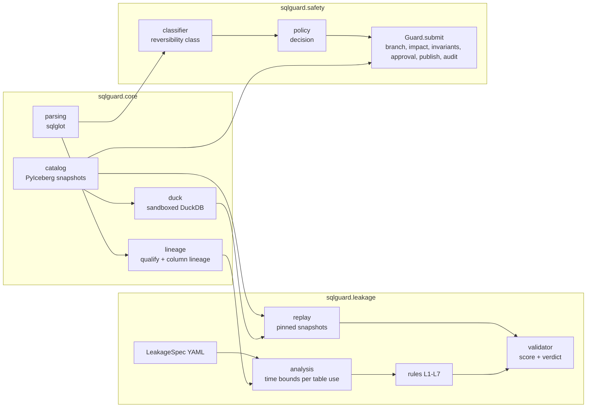
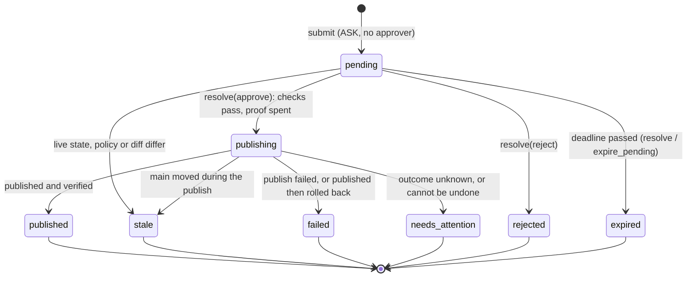

# Architecture

`lakehouse-sql-guard` checks SQL **before it runs** against an Apache Iceberg lakehouse.
Two modules share one SQL-analysis core:

- **Leakage**: is this training-set query using data that was not available at
  prediction time?
- **Safety**: may an AI agent run this action, and if so, how (directly, through a branch
  rehearsal, after human approval, or not at all)?



## Core (`src/sqlguard/core`)

| Module | Role |
|---|---|
| `parsing.py` | Parse SQL with sqlglot into statements; parse errors raise `SqlParseError`. |
| `lineage.py` | Qualify a query against a schema and compute column-level lineage. |
| `catalog.py` | `LakehouseCatalog.local` (file-based `SqlCatalog`) or `from_config` (any PyIceberg catalog: REST, Glue, SQL, configured by `~/.pyiceberg.yaml` or `PYICEBERG_CATALOG__*`); the shared `--catalog` / `--warehouse` flags; snapshot history with a *logical* visibility time (`sqlguard.logical-ts` summary property, falling back to commit time); main-branch time travel; detection of expired history. |
| `duck.py` | In-memory DuckDB over Arrow tables. File and network access are disabled and the setting is locked, so untrusted SQL only sees the tables it is given. |
| `findings.py` | `Finding`, `Severity`, `Decision` shared by both modules. |

## Leakage (`src/sqlguard/leakage`)

**Input.** The SQL that builds a training set, plus a `LeakageSpec` that *declares* time
semantics (nothing is inferred from names): the label table and its prediction-time
column, the event-time column of each temporal table, optional ingestion-time columns,
static tables, and outcome columns that are only known after the label. Optional fields
(`boundary`, `max_ingest_delay`, `label_known_after`, `relations`) settle judgment calls the
SQL cannot; `spec.py` is their schema and the README explains them.

**Static analysis** (`analysis.py`). The query is qualified and split into scopes. Every
physical table use becomes a `TableRef`. Each AND-ed term of a WHERE / ON / HAVING clause
is normalized to

```
<time column of table use R>  OP  <prediction_ts of the label spine> + offset
```

through aliases, CTEs, derived tables, correlated subqueries, casts, `date_trunc`, and
dialect date arithmetic. Predicates under OR, NOT or CASE never count as bounds; an
aggregate `FILTER` counts only under the conditions in `docs/limitations.md`. A CTE
reused twice must be bounded at each use. Window functions that look ahead (`LEAD`,
`FOLLOWING`) or aggregate a whole partition are recorded separately.

**Rules** (`rules/`):

| Rule | Leak |
|---|---|
| L1 | Reads facts at or after prediction time (lower bound ≥ t, upper bound ≥ t + 1 day, look-ahead windows). |
| L2 | Joins a temporal table with no upper time bound. |
| L3 | Aggregates (or window-aggregates) a temporal table with no upper bound. |
| L4 | Bounded by event time only while the table declares ingestion time: late rows may leak. A hint, weighted below the threshold. |
| L5 | Boundary errors: inclusive `<=` at t (unless the spec says `boundary: inclusive`), a forward shift under a day, or mixed tz-aware/naive comparison. |
| L6 | Features derived from the label or from outcome tables (lineage, predicates, expressions). Labels the spec declares final (`label_known_after`) may be aggregated. |
| L7 | Reads the wall clock (`now()`, `current_date`, ...) in a feature. A filter that only chooses which spine rows to train on is exempt. Replay cannot see it. |

**Replay** (`replay.py`). For a sample of prediction timestamps (half the busiest ones,
where batch-aligned boundary leaks concentrate, half random), every table is pinned to the
snapshot visible strictly before `t` (at `t` with `boundary: inclusive`), the label table
holds the rows at `t` (earlier rows only as context, with their labels hidden), and the
query is re-run. Any difference from the normal run means a value was not knowable at
`t`. This is what confirms L4: the SQL looks right, the data arrived late. If the needed
history was expired, or a table's history starts after `t`, replay reports `unverifiable`
instead of guessing.

**Verdict** (`validator.py`). `score = 1 − Π(1 − wᵢ)` over findings and a replay
mismatch, with weights in `weights.yaml`. `leaky` when the score reaches the threshold;
`unverifiable` when the guard could not check part of the query (non-SELECT input,
undeclared table, spec/schema mismatch, lineage failure, expired history, or an L4 hint
without replay); otherwise `clean`. The guard never reports `clean` by default.

## Safety (`src/sqlguard/safety`)

**Classify** (`classifier.py`). Each statement or maintenance action gets a reversibility
class (read, reversible write, risky write, irreversible, out of scope, unknown) from its
AST and the catalog state. `EXPLAIN` of a read-only query is a read of the same tables;
`EXPLAIN` of anything else is unknown, because `EXPLAIN ANALYZE` runs the statement.

**Decide** (`policy.py`). A YAML policy maps classes and the task scope to `allow`,
`allow_via_branch`, `ask`, or `deny`. Unknown input is denied.

**Execute** (`guard.py`, `executor/`). `Guard.submit(action, task_scope, approver)`:

1. `deny` → nothing runs. `ask` without an approver → nothing runs, or, when the Guard has an
   action store, the write is rehearsed and queued (see *Pending actions*).
2. Writes are rehearsed on an Iceberg branch; the impact (rows added, deleted, modified,
   schema changes) is measured and invariants (`max_delete_pct`, `not_null`,
   `unique_key`, ...) are checked before publishing.
3. The policy is re-applied with the measured impact; an approver sees the impact report.
4. Publishing is a compare-and-swap of main's head to the snapshot that was measured; a
   diverged main is refused (see *Publish by snapshot id*).
5. Post-publish invariants run on the published snapshot; failure rolls back, but only if
   main still points at that snapshot.
6. Every decision is written to an append-only JSONL audit log.

Maintenance (`expire_snapshots`, `remove_orphan_files`, rollback, fast-forward) is
planned as a dry run first. Expiring snapshots removes time travel; deleting orphan files
afterwards removes the data physically, so both are irreversible and need approval.
`remove_orphan_files` only deletes files under the table location that no retained
snapshot or ref references, re-checked against fresh metadata at deletion time.

### Executor capabilities

Every adapter (`executor/base.py`) carries an `engine` name and a frozen `Capabilities`:
`branch_write`, `publish`, `rollback`, `expire`, `orphan_cleanup`, `changelog`. All default
to `False`; an engine opts in. The Guard consults `branch_write` before it lets a write
near the engine: a SQL write on an engine that cannot run DML on an isolated branch is
denied up front with the reason `no isolated rehearsal on <engine>` (also when the policy
would only have asked for approval), because the rehearsal is what makes a write safe to
publish. Reads and policy denials are unaffected. An adapter without a `capabilities`
attribute is treated as capable of nothing. `DuckDBIcebergAdapter` and `SparkIcebergAdapter`
declare everything except `changelog`.

### Publish by snapshot id

`ExecutorAdapter.publish(branch, expected_head)` moves main to the snapshot `expected_head`
and nothing else. The Guard obtains it from `diff()`, which returns a `BranchHandle` whose
`head_snapshot_id` is the head it measured; the same snapshot is the one an approver is
shown. Anything written to the branch afterwards is not published, which a ref-based
fast-forward (Iceberg's `fast_forward` procedure, `fast_forward_branch`) cannot guarantee.

Steps, identical for every adapter because Spark publishes through the same PyIceberg
code against the same catalog: reload the table; main must still be the branch's base
(`BranchDiverged` otherwise); `expected_head == base` is a no-op; the base must be an
ancestor of `expected_head`; `set_current_snapshot(snapshot_id=expected_head)`, whose
commit carries the catalog's own assertion on the main ref (a writer that slips in makes
it fail with `BranchDiverged`). Then main is read back and the publish counts as landed when
main is on `expected_head` **or has it in its history** (other writers committed on top).

Nothing is ever rolled back from the publish step, because undoing it past another writer's
commit would destroy their work:

- Other writers on top, post-publish verification passes: `published`.
- Other writers on top, verification fails: the rollback's compare-and-swap refuses
  (main is no longer on the published snapshot), so the result is `rollback_blocked` with
  `needs_attention`.
- Main no longer has `expected_head` in its history (`PublishMismatch`), or the commit's
  outcome is unknown and main cannot be read back or still reads as unchanged
  (`PublishStateUnknown`): `rollback_blocked`
  with `needs_attention`, main untouched.
- An unknown commit state (`CommitStateUnknownException`, 5xx, timeout, lost connection) is
  settled by reading main back, with retries: on `expected_head` or beyond is a success;
  still at the base is *not* proof that nothing landed (a gateway timeout can precede a late
  commit), so it is an attention case too; only a rejected compare-and-swap
  (`CommitFailedException`) proves not-published. A confirmed commit response is trusted if the read-back itself fails.

On Spark the table cache is refreshed (`REFRESH TABLE`) after each such commit, since a
PyIceberg commit bypasses Iceberg's `SparkCatalog` cache. The approved fast-forward
*maintenance action* moves main to the snapshot recorded in its plan the same way.

`BranchDiff.branch` (the handle carrying the measured head) is a required field; code that
builds a `BranchDiff` itself must supply it.

A SQL catalog stores every table under the catalog name it was created with, so a
warehouse written by `LakehouseCatalog.local` (name `sqlguard`) is opened by
`from_config("sqlguard", ...)`.

### Pending actions

With `Guard(store=...)`, an `ask` submitted *without* an approver is kept instead of dropped.
(An approver passed to `submit` always gets the synchronous path described above, store or
not.) The write is rehearsed on an audit branch as usual; then, instead of waiting in memory,
it is saved in an `ActionStore` (`safety/store.py`, one SQLite file) and the branch is kept.
`submit` returns `Outcome.AWAITING_APPROVAL` with an `action_id` and an `action_hash`.

`AWAITING_APPROVAL` therefore has two meanings, told apart by `GuardResult.action_id`:

| `action_id` | Meaning |
|---|---|
| `None` | No store. Nothing was rehearsed or saved; call again with an approver. |
| set | Store. Rehearsed, measured, saved, and still decidable with `Guard.resolve(action_id, ...)`. |

Maintenance (`expire_snapshots`, `remove_orphan_files`, rollback, fast-forward) is queued
the same way, with its dry-run plan instead of a branch. Reads, and statements that cannot be
rehearsed on a branch (DDL), are never queued (the latter come back `unsupported`). A table too big
to diff (see below) is refused with `denied`, because an approver must be able to read the change.



A transition is one `UPDATE ... WHERE id = ? AND state = ?` under `BEGIN IMMEDIATE`, so two
processes racing for an action cannot both win; any other edge raises `InvalidTransition`.
The file is WAL-mode, mode 0600, and holds **no nonce or secret**: `used_proofs` keeps only a
hash of each accepted proof. At a terminal state the raw SQL (`sql_normalized`) and the
detailed maintenance plan are erased, with `secure_delete` and a WAL truncate so the bytes are
really gone; the redacted SQL, the sha256 *of the redacted SQL* (a hash of the raw text would let
a guessed literal be confirmed), digests and counts stay. No row value is ever stored. The WAL
truncate cannot run while another connection holds a read transaction (a UI, the `sqlite3`
CLI), so the erased bytes can linger in `-wal` until the reader is gone; `expire_pending` and
`reconcile` repeat it, so the guarantee is "eventually", not "at the instant of the transition".
The store carries a schema version (`PRAGMA user_version`, now 2). A new file is stamped; a
version 1 file is upgraded in place by adding `owner`, `lease_until` and `drop_pending` (its
pending actions were hashed before the display fields were bound, so they no longer match their
`action_hash` and `resolve` ends them as `stale`: an upgrade never re-blesses a row); a file
from a newer build, or with tables but no version, is refused with `StoreError`. Any later
column change must bump the version and add its step to `ActionStore._prepare`.
Tables: `actions(id, created_at, expires_at, state, kind, dialect, sql_normalized, sql_redacted,
sql_sha256, maintenance_json, scope_json, catalog_name, engine, "table", base_snapshot_id,
head_snapshot_id, branch, policy_digest, invariants_digest, diff_digest, action_hash,
impact_json, reasons_json, requester, approver, decided_at, outcome_json, owner, lease_until,
drop_pending)` and `used_proofs(proof_hash, used_at, action_id)`.

**What an approval is bound to.** `action_hash = sha256(canonical{kind, dialect, normalized SQL
or maintenance action, table, catalog name, engine, base and head snapshot ids, policy_digest,
invariants_digest, diff_digest, requester, scope, branch, expires_at, and the display fields
sql_redacted, impact_json, reasons_json})`. SQL is normalized by sqlglot (no comments)
before hashing, so spelling does not matter. The hash is not a secret and not a security
boundary on its own (anyone who can read the SQL, catalog and policy can recompute it); the
barriers are the proof key held outside the store and the host's permission rules. An approval
UI should still render from bound data only (`diff_for` checked against `diff_digest`). `policy_digest` is the sha256 of the parsed
policy's canonical form (`Policy.digest`); the YAML `version` is only a label.
`diff_digest` fingerprints every changed row between base and head (a plan digest for
maintenance), so what a reviewer saw is what is hashed.

**`Guard.resolve(action_id, decision, approver_label, proof)`.** The proof is produced out of
band by the approval UI or CLI and checked by an injected `ProofVerifier`; the Guard holds no
key. For `approve`, in this order and before any proof is spent:

1. not expired; the stored row still hashes to its `action_hash`;
2. `policy_digest` and `invariants_digest` equal the current ones; same engine and catalog;
3. main is still on `base_snapshot_id`; the branch still ends at `head_snapshot_id`;
4. the SQL is re-classified and `policy.decide` is re-run with the *stored* scope and the
   re-measured impact; only ASK or ALLOW_VIA_BRANCH may continue (DENY, or anything else, is
   stale); pre-publish invariants are re-evaluated;
5. the row diff recomputed from the two snapshots has the stored `diff_digest`
   (maintenance: re-planning gives the stored plan digest, and the retention rules still pass).

Any miss ends the action as `stale` (`Outcome.STALE`, reasons say which) and drops the
branch. Then the proof is spent in the same transaction that moves the action to
`publishing`, and the recorded head is published by snapshot id and verified exactly as in the
synchronous path. A proof that was used before raises `ProofRejected` and changes nothing.
`reject` verifies the proof, spends it, and drops the branch. Unexpected errors after the claim
leave the action in `publishing` for `reconcile`.

**Ownership of `publishing`.** Claiming an action records an `owner` (`host|boot id|PID namespace|pid|token`) and a
`lease_until` (default 5 minutes). While the resolver works, a heartbeat renews the lease, and
it renews and re-checks it right before the commit; if another process took the row over, the
resolver publishes nothing (outcome `ERROR`, "taken over") and touches neither the row nor the
branch. The terminal update is conditional on still being the owner.

**`Guard.reconcile(grace=0)`** (call it when the UI or MCP server starts; it is safe next to
running resolves and other reconcilers) settles `publishing` rows whose publisher is gone. It
leaves a row alone while the lease (plus `grace`) is fresh, while the owner is working in this
process or is a live process in this PID namespace, and when the row was queued for another catalog or
engine. Otherwise it takes ownership by compare-and-set and decides from main:

- main on `head`: post-publish checks (`published`, or rolled back to `base` and `failed`, but
  only if main is still exactly on `head`);
- main on a later snapshot with `head` in its history: verified without any rollback
  (`published`, or `needs_attention`). For a pointer move to an *older* snapshot (rollback) this
  counts only if `base` is no longer in main's history: a writer who committed on top of the
  untouched base also has the target in its history, and that is not a rollback;
- main still on `base`: `failed` only when the owner is *proven* dead: same host, same boot id
  and same PID namespace, all known, and no such pid. A peer in another container (same
  hostname, own PID namespace), a row written before a reboot, another machine, or a platform
  that cannot tell (macOS has no boot or namespace id to compare) is not provable, so the
  commit might still land and the row is `needs_attention`, after the lease runs out;
- anything else, and expiry or orphan cleanup (cannot be told from a half-done run):
  `needs_attention`.

A `needs_attention` row keeps its branch. A crashed publish keeps its lease until it runs out,
so a reconcile right after the crash skips it; run it again after the lease.

**`Guard.expire_pending(now)`** expires this Guard's pending actions past `expires_at` (default
24 hours after creation) and drops their branches. A drop that fails leaves the row marked
`drop_pending` and is retried by later `expire_pending` / `reconcile` runs.
`Guard.sweep_orphan_branches()` (also run by both) drops `sqlguard-` branches that no
unfinished action owns, whose head is not on main's history and is older than the pending
lifetime plus an hour; a branch still at its base holds nothing and may belong to a running
submission, so it stays. The queue holds at most `max_pending` (default 50) pending actions.

### Row diff

`impact.compute_row_diff(table, base_snapshot_id, head_snapshot_id, ...)` extends the impact
measurement with a reviewable, fingerprinted list of changed rows, always base to head. Rows are
matched with a keyed DuckDB FULL OUTER JOIN using `IS DISTINCT FROM` per column; the key is
`table_key(table)`: the Iceberg identifier fields, else the policy's `unique_key`, else no key
(whole rows compared as multisets with `EXCEPT ALL` in both directions, labelled `unkeyed`; a
modified row is then one deleted plus one added row). A key that is NULL or repeated on either
side is not used, and `key_note` says so. At most 200 rows are listed; the totals and the digest
cover all of them.

Only the comparison happens in DuckDB; what is read back is plain data. Columns whose Python
form is plain (integers, floats, strings, bytes, dates, microsecond timestamps without a zone,
decimals) are read as such; every other type (`timestamptz`, nested struct/list/map,
nanosecond timestamps, intervals, ...) is read as text, with the session time zone fixed to UTC
so the text does not depend on the host. That keeps the diff free of Python objects that would
need modules which are not dependencies (`pytz`), and the listed values for such columns are
strings. A diff failure is logged (`sqlguard.diff`) and reported with a generic reason; engine
and library text never reaches a denial or stale reason. Limit: DuckDB compares `0.0` and `-0.0`
as equal, so a change between them is invisible to the impact and the diff (the publish then
reports no change).

The comparison always covers both snapshots whole: no part of the statement is used to narrow
the scans, because the engine and Arrow disagree on NaN ordering and float coercion, and a row
the filter dropped would be a row the reviewer never saw. The Guard builds the diff from the
base and head data the adapter already loaded, and refuses to offer an action whose diff does
not add up to the measured impact (same net row change, and the same added / deleted / modified
counts when both used the same key). Each snapshot is limited to 1,000,000 rows and 256 MB
(`compute_row_diff` checks file metadata before reading and the Arrow data after; the Guard
checks the loaded data); above that the diff raises `DiffTooLarge` ("table too large to diff")
instead of showing a partial one. The caps bound the diff, not the adapter, which loads both
snapshots to rehearse a write.

### CLI registry

`sqlguard` (`src/sqlguard/cli/`) is a package: `__init__.py` owns the root parser, `main`
and the registry; each command group is a module that calls
`register(name, add_parser, handler)` when imported. `add_parser(subparsers)` builds the
group's parser and returns it; `handler(args)` runs the chosen command and returns the exit
code (`main` turns `OSError` / `ValueError` into exit code 2). `build_parser` imports the
group modules (`leakage`, `safety`, `approvals`) and mounts whatever registered, in
registration order, so a new group needs its own module and no edit to another group's.
`approvals.py` is reserved and registers nothing yet. Catalog flags come from
`core.catalog.add_catalog_args` / `catalog_from_args` and are shared by the groups that
open a lakehouse (`--catalog NAME` or `--warehouse PATH`, plus `--catalog-namespace`);
`sqlguard-mcp` takes `--catalog` / `SQLGUARD_CATALOG` as an alternative to `--warehouse`; it
keeps its own flag parsing (environment-variable defaults, `--namespace`, parse and open are
separate steps) and shares only `from_config`. Its default executor rewrites whole tables in
memory, so `--catalog` should not be pointed at a large production table yet.
`from_config` errors have URI passwords and secret-looking values removed before they are shown.

## Benchmarks (`bench/`)

- `bench/leakage`: a synthetic Iceberg world with nightly batches and late-arriving rows,
  SQL templates per leak type, and a real dataset (UCI Online Retail II) with simulated
  load delays. Detectors: a baseline (output timestamps after prediction time), static,
  replay, and combined. Thresholds are pre-registered on the dev split at FPR ≤ 5% and
  committed with the git SHA before held-out templates exist.
- `bench/safety`: tier 1 runs hand-written actions through the classifier and policy;
  tier 2 runs an LLM agent with and without the guard and scores the resulting table state.
