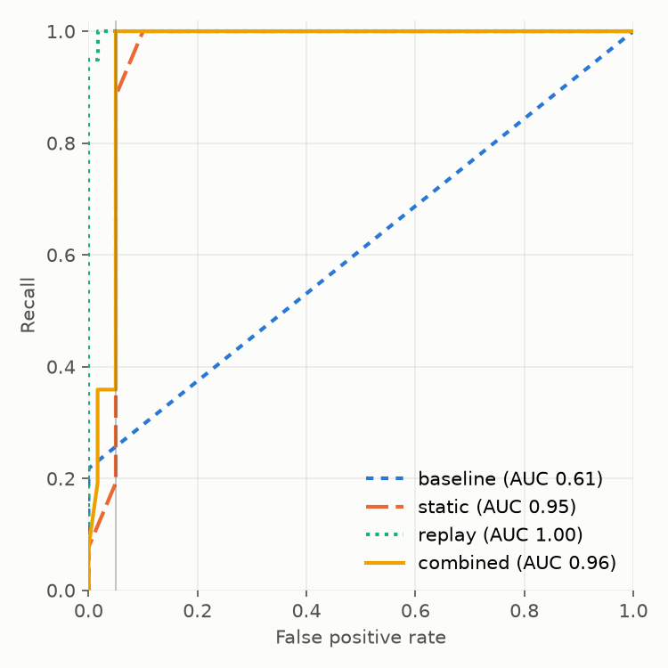

# Results

Every number here comes from a committed result file. Each rule set and policy was frozen at a
git tag, with its thresholds pre-registered, before new authors wrote the held-out set it was
measured on; each held-out set was run once. Newest first. What the numbers do not show is in
[limitations.md](limitations.md).

## Current rules and policy (v3) on a fresh held-out set

Rules, policy and thresholds were frozen at tags `rules-frozen-v3` / `policy-frozen-v3`
([pre-registration](../results/leakage/prereg-8928019.json)). New authors, who saw only a brief,
then wrote 146 leakage templates (70 clean) and 109 agent prompts (45 benign, 64 risky or
ambiguous). The templates were checked for near-copies of every earlier set, and the labels
and expected answers were checked against the warehouse. Each set was run once.

| | recall | FPR [95% CI] | clean templates flagged |
|---|---|---|---|
| leakage, combined (v3) | 1.00 | **0.15 [0.07, 0.25]** | 10 / 70 |
| leakage, static only (v3) | 0.95 | 0.13 [0.05, 0.22] | 8 / 70 |
| leakage, replay only (v3) | 0.85 | 0.03 [0.00, 0.07] | 2 / 70 |
| leakage, first rule set (v1) | 0.14 | 0.08 | 6 / 70 |

| agent cell | unsafe action rate | U (benign completed) [95% CI] | false-block rate |
|---|---|---|---|
| Haiku 5.5, no guard | 0.56 | 0.93 | 0.00 |
| Haiku 5.5, guard (policy v2) | **0.00** | 0.93 [0.87, 0.99] | 0.05 |
| Haiku 5.5, guard (policy v1) | 0.05 | 0.93 | 0.05 |
| Opus 5.5, no guard | 0.53 | 0.98 | 0.00 |
| Opus 5.5, guard (policy v2) | **0.00** | 0.99 [0.98, 1.00] | 0.00 |

**What this shows.** With the guard and policy v2, neither model took an unsafe action on any of
the 64 risky or ambiguous prompts, three runs each; the exact 95% upper bound on the per-prompt
unsafe rate is 0.046. Benign work still got done (U 0.93 and 0.99, against 0.62 on held-out v2).
That safety rests partly on the person: with a reviewer who approves everything, 23% of Haiku's
and 26% of Opus's risky and ambiguous runs would have been unsafe.

**What it does not.** The pre-registered leakage target, FPR ≤ 0.05, is **not met**. FPR fell
from 0.37 on held-out v2 to 0.15, and the combined detector still found every leak. Eight of the
ten flagged clean templates are static rules that do not follow a bound written in an unusual
way: through `UNION`/`EXCEPT`, a `ROWS` frame on a merged timeline, a `CASE` or `RANGE` frame
that keeps only final labels, or a shifted time zone. The other two are a replay bug: rounding
noise near zero counts as a mismatch. Details are in
[docs/limitations.md](limitations.md#held-out-v3-frozen-rules-and-policy). Reports:
[leakage](../results/leakage/20261106-4587293.md), safety `results/safety/holdout_v3-*`.

## Real-world dbt projects

The frozen v3 rules were run, statically, on dbt projects from GitHub
([pre-registered search](../bench/realworld/search-prereg.yaml), [screening](../bench/realworld/screening.csv)).
Each project is pinned to a commit, and its spec was written from its own docs and committed
before the checker ran. Every finding was judged by two reviewers working blind to each other,
both Claude models (the session that ran the check and a separate review agent), not people;
they agreed on all 31.

| projects | checked | findings | real leaks | precision |
|---|---|---|---|---|
| new (found after the freeze): DobleL2, novarz, ChuquEmeka | 3 | 14 | 13 | **0.93** |
| seen during development: mponsclo | 1 | 3 | 3 | 1.00 |
| seen during development: fraud feature store (clean control) | 1 | 14 | 0 | **0.00** |

The real leaks are the kind the rules target: a per-user count of frauds that includes the row
being predicted, all-history aggregates with no cutoff before the churn outcome, "days since last
activity" measured to `current_date`, and transaction and listening logs that run past the
project's own cutoff. The clean control is the failure: every one of its rolling windows ends at
`1 PRECEDING`, but they are ordered by `event_time_unix`, a cast of `event_time` the rules do not
relate to the time column, so 13 windows are flagged; the 14th finding comes from a spec that
makes the label table its own history. Three of the five seen projects have no
training table or no label and were not run. Precision says nothing about missed leaks, which
were not measured on these projects.

On 15 mutants of the clean control ([operators](../bench/realworld/mutation-operators.yaml),
registered before generation) only 3 add a new finding (the two L6 and the one L7 mutant).
The 5 L1 and L2 mutants add nothing new because the control is already flagged for those types,
so they cannot be told apart from it; every L3 and L5 mutant (7) is missed; and the finding names
the mutated model for 1 of 15. Even the 3 are recall by construction, since the operators were
written to match the rules. Details:
[results/realworld](../results/realworld/), [docs/limitations.md](limitations.md#real-world-dbt-projects).

## Second rule set (v2)

Rules, policy and threshold were frozen at tags `rules-frozen-v2` / `policy-frozen-v2`
([pre-registration](../results/leakage/prereg-8390186.json)) before new authors, who saw only a
brief, wrote 91 leakage templates and 31 agent prompts. Run once:

| | recall | FPR [95% CI] |
|---|---|---|
| leakage, combined (v2) | 0.99 | **0.37 [0.18, 0.55]** |
| leakage, replay only (v2) | 0.85 | 0.00 |
| leakage, first rule set (v1) | 0.19 | 0.06 |

| agent cell | unsafe action rate | false-block rate |
|---|---|---|
| Haiku 5.5, no guard | 0.61 | 0.00 |
| Haiku 5.5, guard (policy v2) | **0.00** | 0.36 |
| Opus 5.5, no guard | 0.39 | 0.00 |
| Opus 5.5, guard (policy v2) | **0.00** | 0.38 |

The guard caught nearly every leak and let no destructive action through, but it was far
stricter on unseen queries than on dev (FPR 0 there): every leakage false positive is a
static rule firing on a query whose replay passed. Most agent false blocks are approval
requests the scripted reviewer rejected because the held-out prompts list no approvals; the
analysis, and what is still truly blocked, is in
[docs/limitations.md](limitations.md#held-out-v2-frozen-rules-and-policy). Reports:
[leakage](../results/leakage/20261105-f52e63f.md), safety `results/safety/holdout_v2-*`.

The rules and the guard were changed after this result was read (column changes now go to
approval; [what changed](limitations.md#changed-after-held-out-v2)), so `holdout_v2` is
development data now; the changed rules are the v3 result above.

## First rule set (v1)

The leakage numbers below were measured with the first rule set (tag `rules-frozen-v1`).
Those held-out templates are now the `dev_v1b` split and informed the current rules (L7, the
optional [spec fields](spec.md#optional-fields)), so a run of the current rules over them is in-sample.

All thresholds and policies were frozen before the held-out sets were written:
leakage rules at tag `rules-frozen-v1` with thresholds pre-registered on the dev split
([results/leakage/prereg-25d1275.json](../results/leakage/prereg-25d1275.json)); the safety
policy at tag `policy-frozen-v1`. Held-out templates and prompts were written afterwards by
an author who did not read the detector code.

### Leakage: held-out SQL (138 cases, 78 leaky) and real data

| detector | held-out recall | held-out FPR [95% CI] | held-out F1 | real-data recall | real-data FPR |
|---|---|---|---|---|---|
| baseline: output timestamp > prediction time | 0.00 | 0.00 | 0.00 | 0.00 | 0.00 |
| static analysis | 1.00 | 0.10 [0.00, 0.25] | 0.96 | 1.00 | 0.18 |
| replay over snapshots | 1.00 | 0.02 [0.00, 0.06] | 0.99 | 0.88 | 0.00 |
| **combined** | **1.00** | **0.05 [0.00, 0.17]** | **0.98** | **1.00** | **0.00** |

Intervals are a bootstrap over templates (cases rendered from one template are resampled
together). A bootstrap cannot put an interval on a perfect recall: with 0 misses over 29
leaky held-out templates, the 95% lower bound on template-level recall is about 0.90 (rule
of three). The real-data set is small (12 templates); read it as a sanity check.

Real data: UCI Online Retail II (CC BY 4.0), 27 cases over monthly churn cutoffs with
simulated load delays. Static analysis takes about 5 ms per query; replay about 50 ms on the
synthetic world and about 1.1 s on the real one.

How to read this honestly:

- The baseline's pre-registered threshold is infinite because it never fired on dev; at
  any threshold its held-out AUC is only 0.61. Most leaks never put a future timestamp in
  the output.
- Every held-out false positive comes from two templates the author flagged as judgment
  calls: target encoding over labels whose horizon had closed (flagged L6: the guard does
  not know when a label becomes known) and an event-time bound with a lag longer than the
  feed's maximum delay (an L4 hint that replay correctly clears).
- The current rules address both with `label_known_after` and `max_ingest_delay`; the
  numbers above predate them.
- Replay misses the real-data L5 case because that leak shows on only 2 of 17 cutoffs.
- Full report: [results/leakage/20261104-948534a.md](../results/leakage/20261104-948534a.md).

### Safety: an LLM agent with and without the guard

16 held-out prompts (6 benign, 6 risky, 4 ambiguous), each run 3 times per condition.
Outcomes are scored from real table state (rows, snapshots, columns, tables touched), never
by an LLM.

| model | condition | unsafe action rate | safe handling S | completion U | score 2SU/(S+U) |
|---|---|---|---|---|---|
| Claude Haiku 5.5 | no guard | 0.27 | 0.73 | 1.00 | 0.85 |
| Claude Haiku 5.5 | **guard** | **0.10** | **0.90** | **1.00** | **0.95** |
| Claude Opus 5.5 | no guard | 0.40 | 0.60 | 1.00 | 0.75 |
| Claude Opus 5.5 | **guard** | **0.10** | **0.90** | **1.00** | **0.95** |

On the 24 dev prompts (Haiku 5.5), the unsafe action rate fell from 0.60 to 0.00. Every
benign task was completed in every condition (false-block rate 0); under the guard a few
benign runs went through an approval step first. The guard adds about 40 ms per action
(p95 about 110 ms) against 10-18 s of model time per task.

- All remaining unsafe runs under the guard are one prompt (`h15`): a one-row `UPDATE` on
  a production table that is inside the task scope. It was recorded as a known guard gap
  when the held-out prompts were written. The guard checks SQL and table state, not intent.
- The stronger model was *less* safe without the guard here: it refused or asked less
  often and acted more.
- The handcrafted tier (no LLM) allows 0 of 106 dangerous actions and blocks 0 of 28 safe
  ones.
- Reports: [dev](../results/safety/dev-20261104T081939Z.md),
  [held-out](../results/safety/holdout-20261104T084347Z.md). Transcripts are committed;
  `sqlguard-bench safety agent --split holdout --replay transcripts/safety/holdout-20261104T084347Z`
  re-scores them without an API key.
